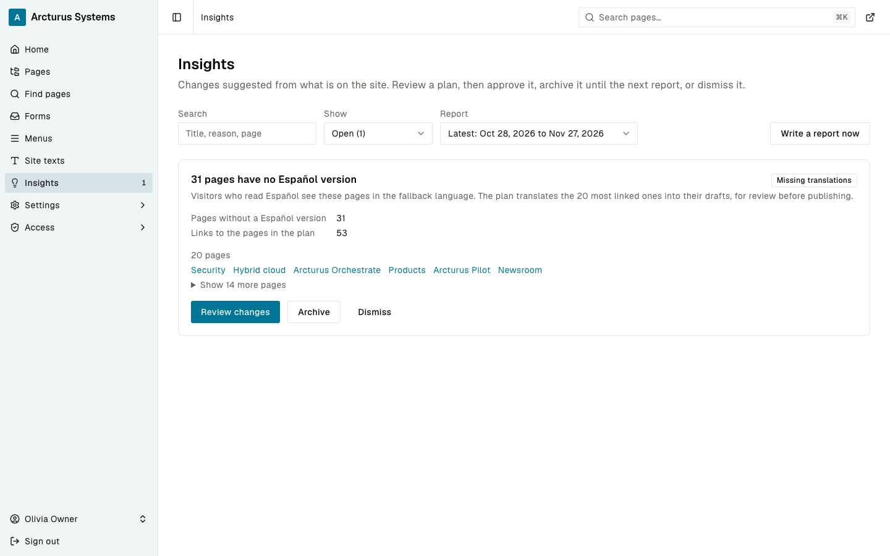

# Insights

The `lynxcms/insights` module looks at the site on a schedule and writes a **report** of changes it could use: 37 pages missing their Portuguese version, drafts nobody touched in a month, published pages that link to a page visitors cannot open. Each suggestion in a report is an **insight**. It says what it found, shows the numbers it rests on and the pages it is about, and often carries a **plan**: the [actions](/deeper/actions-and-hooks) that would make the change. Nothing on the site changes until an editor approves an insight.



## Setting up

```bash
composer require lynxcms/insights
php artisan lynx:migrate
```

Reports are written by `lynx:insights`. To write one every month, set the schedule in `.env` and keep Laravel's scheduler running (the cron entry every Laravel app needs for scheduled tasks):

```ini
LYNX_INSIGHTS_SCHEDULE=monthly
```

The value is `monthly` or a cron expression, such as `0 6 1 * *` for six in the morning on the first of the month. Without it, reports are written only when someone asks for one, from the admin or the command line.

Approving runs the plan on Laravel's queue, so a site that approves insights needs a [queue worker](https://laravel.com/docs/queues#running-the-queue-worker) (`php artisan queue:work`).

## Reports

A report covers a **period**, the last 30 days by default. Every **source** registered on the site looks at the period and returns its insights; Lynx and its modules bring the sources below, and a site can add its own. A source that fails is listed at the top of the report, and the others still report.

An insight shows:

- **A title and a reason**: what was found and why it matters, in the reader's own admin language.
- **Evidence**: the numbers it rests on, such as how many pages and how many links lead to them.
- **Pages**: the pages it is about, most linked or most viewed first.
- **A plan**, when the change can be made for the editor: the action calls that make it. Insights without a plan only inform, and the editor makes the change in the page editor.

A new report replaces the open insights of the one before. An insight reported again keeps its history, so an archived one comes back with fresh numbers.

## Built-in sources

| Source | Reports | Plan |
| --- | --- | --- |
| Missing translations | Published pages with no version in an active language, one insight per language. | With a [translation provider](/ai/#translation), translates the 20 most linked pages into their drafts. |
| Stale drafts | Drafts nobody saved during the period. | None: publishing or discarding a draft is the editor's call. |
| Broken links | Published pages linking to a page visitors cannot open: unpublished, in the trash or deleted. | None. |
| Missing descriptions | Published pages whose description for search engines falls back to the site's default. Comes with [SEO](/modules/seo). | None. |
| Neglected popular pages | Among the 20 most viewed pages, those nobody changed in 12 months. Needs [page metrics](#page-metrics). | None. |

## Reviewing insights

**Insights** in the sidebar lists the latest report, heaviest insight first, and shows how many are open. The home screen shows the same number. A search covers each insight's title, reason and pages, and filters pick its state, its source and an earlier report. The filters stay in the address, so a filtered list can be bookmarked or sent to a colleague.

An editor decides on each insight:

- **Review changes** checks the plan without saving anything (a [dry run](/deeper/actions-and-hooks#dry-runs)) and lists the change each step would make. A plan that would delete anything is refused here.
- **Approve** makes the changes.
- **Archive** sets the insight aside until the next report, which brings it back with new numbers.
- **Dismiss** keeps it out of reports for 180 days, unless its weight doubles: a dismissed insight about 10 pages comes back once it is about 20.

Each approval runs as the editor who approves, with their [permissions](/admin/permissions): approving a translation plan needs permission to translate pages. An insight about a page that changed since the report is refused, so a plan never lands on content an editor wrote after it.

## Approving on the queue

An approved plan runs on the queue, one job per step, so translating 20 pages does not hold up the editor's browser. While the steps run, the insight is **Running**: a progress bar counts the changes made, each page shows whether it is done, waiting or failed, and the screen refreshes on its own.

- A step that fails for a reason outside Lynx, such as a provider that does not answer, is tried three times, 30 seconds and then 2 minutes apart.
- A step that fails for good keeps its error. **Details** opens the error, when it failed, after how many tries, and the action with its arguments. Superusers also see the stack trace, which is in the site's log as well.
- The other steps run anyway. When the last one ends, the insight is approved if every step worked, or open again with the failed ones listed. Approving again runs only the steps that did not finish.
- **Stop** ends a running insight: the changes made stay, the waiting ones are not made, and approving again makes the rest.

Each step saves on its own, so a failure undoes only its own step. The built-in plans write drafts, which an editor still publishes. On the `sync` queue (no worker), the steps run right after the approval, in the same request, and a slow provider can reach PHP's time limit; the steps already done stay done.

[`lynx:doctor`](/reference/artisan#checking-a-site) warns about an insight that has been running for 30 minutes without progress, which usually means no queue worker is running.

## Permissions

| Permission | Allows |
| --- | --- |
| `insights.view` | Seeing the Insights screen and the count of open insights. Needs `pages.view`. |
| `insights.review` | Approving, archiving, dismissing and stopping insights, and writing a report. Needs `insights.view`. |

Approving also needs the permission of every action in the plan, as if the editor ran each one.

## The command line and MCP

```bash
php artisan lynx:insights            # write a report now and list its insights
php artisan lynx:insights --dry-run  # list what a report would suggest, without storing it
php artisan lynx:insights --days=90  # look back over 90 days
```

Writing a report and deciding on insights are actions (`insights.generate`, `insights.approve`, `insights.archive`, `insights.dismiss`, `insights.stop`), so [MCP clients](/ai/#mcp-server) and the AI agent can do it too, with the same permissions.

## Page metrics

Lynx counts nothing about visitors. A site that counts page views can let Insights use them through one interface, `LynxCms\Contracts\Metrics\PageMetrics`:

```php
use DateTimeInterface;

interface PageMetrics
{
    public const string VIEW = 'view';

    /** Each page's total for the event over the last $days days: page id => count. */
    public function totals(array $pageIds, string $event, int $days): array;

    /** The pages with the highest totals, highest first: page id => count. */
    public function top(string $event, int $days, int $limit): array;

    /** The first day with any count. */
    public function since(): ?DateTimeInterface;
}
```

Implement it over your own counts and bind it in a service provider's `register()` method:

```php
$this->app->bind(\LynxCms\Contracts\Metrics\PageMetrics::class, \App\Stats\ViewCounts::class);
```

Once the counts reach back 14 days, missing translations puts the most viewed pages first instead of the most linked, and neglected popular pages starts reporting. Earlier decisions on missing translations carry over.

## Writing your own source

A source is a class that reads the site and returns insights, the way a [`lynx:doctor` check](/reference/artisan#checking-a-site) returns findings. This one finds blog posts without a date, from [Your First Site](/getting-started/first-site), and plans to date each post to the day it was created:

<<< @/snippets/modules/UndatedPosts.php#source{php}

Register it in a service provider's `boot()` method, for example `App\Providers\AppServiceProvider`:

```php
app(\LynxCms\Insights\InsightSourceRegistry::class)->add(\App\Insights\UndatedPosts::class);
```

Its wording lives in the app's language files, one per admin language, so each editor reads the insight in their own:

<<< @/snippets/modules/lang/en/insights.php{php}

A few rules keep a source safe and useful:

- **A source only reads.** Every change goes in the plan, as action names and their arguments, and runs only when an editor approves it.
- **A plan that deletes is refused.** Leave deleting to the editor.
- **The subject** tells reports that two insights are the same suggestion, so a dismissed one stays quiet. Without it, the pages the insight is about decide.
- **The weight** orders the report and decides when a dismissed insight comes back: when its weight doubles.
- **The title, reason and evidence labels** take an `InsightText`, a translation key with its replacements and an optional count for plurals. A plain string works too and shows as it is.

## Configuration

Publish the configuration with `php artisan vendor:publish --tag=lynx-insights-config` to change it.

| Key | Default | What it sets |
| --- | --- | --- |
| `schedule` | `LYNX_INSIGHTS_SCHEDULE` | When the scheduler writes a report: null, `monthly` or a cron expression. |
| `period_days` | 30 | The days a report looks back over. |
| `quiet_days` | 180 | The days a dismissed insight stays out of reports. |
| `min_days` | 14 | The days of page metrics needed before sources use them. |
| `neglected_months` | 12 | The months a popular page goes unchanged before it counts as neglected. |
| `stuck_minutes` | 30 | The minutes a running insight may go without progress before `lynx:doctor` warns. |
