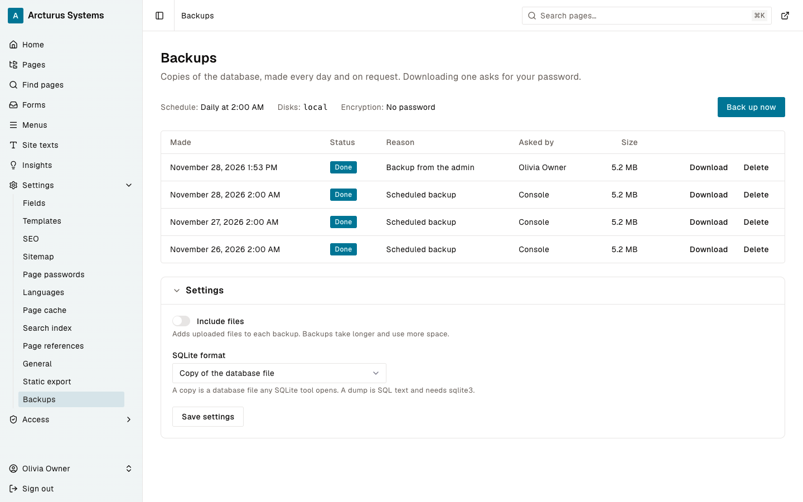

# lynxcms/backup

> [!NOTE]
> This is a read-only split of [`packages/backup`](https://github.com/LynxCMS/lynxcms/tree/main/packages/backup) in the [Lynx CMS monorepo](https://github.com/LynxCMS/lynxcms). Open issues and pull requests there. Lynx is not ready for production yet: see its README.

Database backups for Lynx CMS, on [spatie/laravel-backup](https://github.com/spatie/laravel-backup). Once installed, the scheduler backs up the database every day at 02:00 to the `local` disk, and `lynx:backup:database` makes a backup now. SQLite is copied with `VACUUM INTO`, so it needs no `sqlite3` binary; PostgreSQL needs `pg_dump`. Other modules ask for a backup through `DatabaseBackups` in `lynxcms/contracts`.



## Installing

```bash
composer require lynxcms/backup
php artisan lynx:migrate
```

Add an off-site disk with `LYNX_BACKUP_DISKS=local,s3`, and encrypt the zips with `LYNX_BACKUP_PASSWORD`.

## License

MIT. See [LICENSE](LICENSE).
