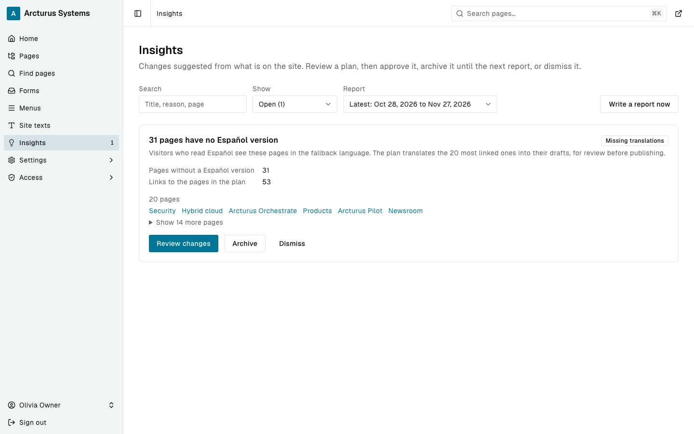

# lynxcms/insights

> [!NOTE]
> This is a read-only split of [`packages/insights`](https://github.com/LynxCMS/lynxcms/tree/main/packages/insights) in the [Lynx CMS monorepo](https://github.com/LynxCMS/lynxcms). Open issues and pull requests there. Lynx is not ready for production yet: see its README.

Insights for Lynx CMS: a report every period of suggested changes, each with its evidence and a plan that editors approve, dismiss or archive. With `lynxcms/admin`, the reports are on the Insights screen, and the home screen shows the number of open insights. Without it, `lynx:insights` writes a report and the MCP server's tools decide on its insights.



## Installing

```bash
composer require lynxcms/insights
```

See the [installation guide](https://github.com/LynxCMS/lynxcms/blob/main/docs/getting-started/installation.md).

## License

MIT. See [LICENSE](LICENSE).
